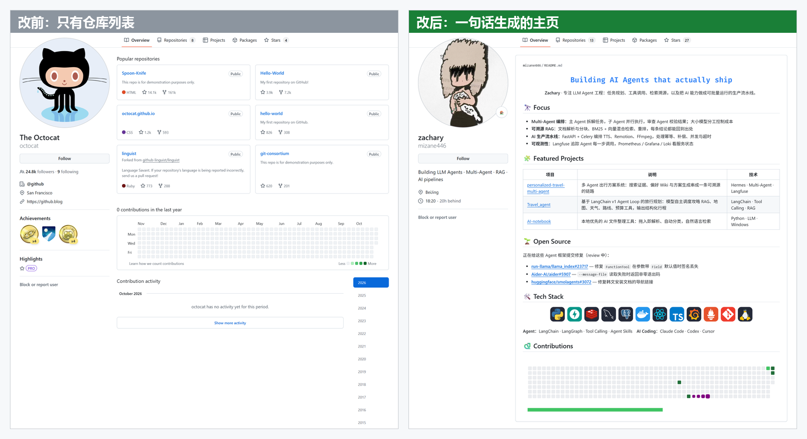
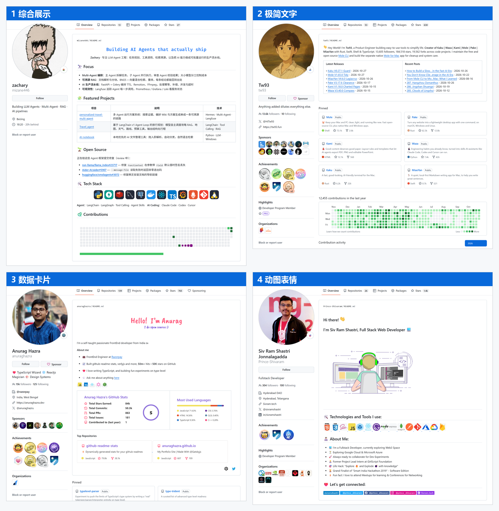

<div align="center">

# github-profile-optimizer

**Transform your GitHub profile into a pro-level showcase in one conversation.**

[](README.md)
[](README.zh-CN.md)

[](LICENSE)
[](https://docs.claude.com/en/docs/claude-code/skills)

No README expertise required. No badge wizardry needed.<br>
Pick a style you like from real examples, and AI handles the rest—<br>
reading your repos, crafting your profile, adding the contribution snake, and publishing.

[See Results](#see-results) · [Installation](#installation) · [Usage](#usage) · [Style Showcase](#style-showcase)

</div>

---

## See Results

<p align="center">
  
</p>

The "after" example above is the author's actual profile, generated with this skill: https://github.com/mizane446

## How It Works

| You Do | AI Does |
| --- | --- |
| **① Pick a style**: Click examples, reply with a number | Shows 4 style categories with real live profiles |
| **② Choose language**: Mixed EN/ZH / Full English / Full Chinese | Reads your public repos & PRs, writes README matching the style layout, validates images & links |
| **③ Authorize**: Open URL, paste device code | Creates username/username repo, updates bio, enables daily contribution snake |

Content is fact-based: merged PRs only, no invented stats, private repos excluded. Your old profile is backed up first—rollback anytime.

## Style Showcase

<p align="center">
  
</p>

| Style | Examples |
| --- | --- |
| 1 Comprehensive | https://github.com/mizane446 · https://github.com/DenverCoder1 |
| 2 Minimalist Text | https://github.com/tw93 · https://github.com/simonw |
| 3 Stats Cards | https://github.com/anuraghazra · https://github.com/ouuan |
| 4 GIF & Emoji | https://github.com/Prince-Shivaram · https://github.com/innng |

Want more inspiration (code art, game interactions, anime themes…)? Check [awesome-github-profile-readme](https://github.com/abhisheknaiidu/awesome-github-profile-readme) and paste any URL to the AI.

## Installation

**Easiest way**: Tell your AI agent (Claude Code, Codex, etc.):

> Install this skill: https://github.com/mizane446/github-profile-optimizer, then help me beautify my GitHub profile

Or clone manually into your skills folder:

```bash
# Claude Code
git clone https://github.com/mizane446/github-profile-optimizer ~/.claude/skills/github-profile-optimizer

# Codex
git clone https://github.com/mizane446/github-profile-optimizer ~/.agents/skills/github-profile-optimizer
```

If your agent doesn't recognize the skill, restart the session. Publishing requires [gh CLI](https://cli.github.com)—the skill will guide installation if needed.

## Usage

Tell your agent:

> Help me beautify my GitHub profile

To preview without publishing:

> Help me beautify my GitHub profile, dry run only

## No AI Agent Yet?

Try the manual form-based generator: https://rahuldkjain.github.io/github-profile-readme-generator/

## License

[MIT](LICENSE). Example screenshots from public profiles; copyright belongs to respective authors.
